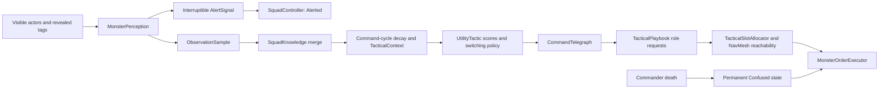

# Commander AI architecture

The local prototype turns squad observations into one explainable tactic, an authored playbook, and simple member orders. The generated arena has one controllable player, two instrumented dummies, a killable commander, and eight ordinary monsters: two each of Shield, Ranged, Charger, and Support. These roles currently describe positioning and basic combat rather than production role abilities.

## Information-to-order flow

1. `MonsterPerception` performs staggered overlap, field-of-view, and raycast sight checks. The implementation currently supplies sight; hearing is a future extension. It observes an `ObservableActor` identifier, position, velocity, timestamp, confidence, and revealed combat tags. There is no loadout inspection by the commander.
2. While Unaware, sight starts a one-second `AlertSignal`. Stun, death, target loss, disable, or cancellation interrupts it. Completion leaves the entire due frame interruptible before publishing the transition. Until success, shared player knowledge remains empty.
3. Once Alerted, reports from living members merge immediately through `SquadController.Report`. Newer observations update spatial facts; older reports can add tags but cannot rewind position. Snapshots copy and sort memories by actor ID. Sharing is independent of difficulty.
4. `CommanderBrain.Tick` gates planning on the profile command cycle, with no catch-up loop. At the cycle boundary it calls `SquadKnowledge.Decay` before building the context. The brain's serialized `memorySecondsToZero` setting defaults to ten seconds, independently of difficulty. Confidence falls linearly from the original observation time and reaches zero without moving the frozen last-known position or erasing observed tags. Fresh reports restore confidence immediately. This integration was added in the evidence task after review identified the missing runtime caller.
5. The read-only `TacticalContext` combines those memories, living role counts, health ratio, objective location, reachable anchor counts, current tactic, and tactic age. `CommanderBrain` never reads player components. Reachability currently recalculates paths; the spec's proposed per-cycle cache is not implemented.
6. Each available `UtilityTactic` checks role requirements and scores named considerations. A weighted geometric mean combines normalized scores; a zero consideration suppresses the tactic. Invalid definitions retain rejection reasons. The winner must exceed its threshold, the profile's hold duration, and the switch margin. Stable tactic IDs break score ties. Full score history is retained for diagnostics.
7. A pending winner starts `CommandTelegraph`; reservations and new playbook orders wait for completion. The playbook then emits role/anchor requests, sometimes carrying an observed support target ID. The allocator filters tag, allowed role, active state, capacity, and complete NavMesh reachability, then selects by distance with an instance-ID tie-break. Stability is for identical scene/context execution; cross-process/network determinism is not promised.
8. `MonsterOrderExecutor` runs one order: move/hold a slot, attack an observed target, protect a unit, search a supplied last-known position, or confused combat. Movement uses a real `NavMeshAgent`; attacks require local range and cooldown. Hidden-target pursuit uses remembered positions. Partial allocation uses explicit fallback orders and records its failure reasons. Invalid movement requests one reassignment notification before falling back; the current brain does not subscribe an automatic replacement planner to that event.

## Lifecycle and diagnostics

`SquadController` owns membership, alert state, shared knowledge, and the permanent Confused transition. `CommanderBrain` owns active/pending tactic state, timing, and orchestration; the allocator owns reservations. Commander death cancels pending/active organization, releases reservations, and assigns deterministic role/ID/seed confusion tendencies to every survivor, including inactive members. New members and replacement commanders cannot restore coordination.

Confused members retain local combat, hold-area, wounded retreat, or frozen-position search behavior. They stop reporting new shared observations and reject organized orders. `CommanderDebugView` exposes state, confidence, score components, reasons, telegraph timing, allocations, and orders. `CommanderGizmoDrawer` exposes anchor and assignment geometry. Presentation remains awaiting a manual pixel/playthrough review; [the demo script](portfolio-demo.md) records that check.

CPU markers wrap real perception batches, knowledge merging/decay, tactic evaluation, allocation, assignment, whole command ticks, planning path checks, and movement path requests. Nested marker costs overlap and must not be added together. [Profiling evidence](profiling.md) separates planner cost from navigation observations and records limitations.

## Later server-authoritative boundary

A future server or authoritative host should own membership/health transitions, verified observations, knowledge, command clocks, utility decisions, reservations, orders, and movement authority. Clients should receive alert/telegraph cues, tactic presentation, member orders, and movement snapshots. They should not submit authoritative knowledge or tactical decisions.

Unity physics/NavMesh calls remain adapters around that authority. Stable network actor/anchor IDs, replication, clock synchronization, prediction/interpolation, and security validation are future work; Unity instance IDs and local unscaled time are not a network protocol. No networking library has been selected. The five-squad stress fixture measures independent squads sharing an arena, not a strategic multi-squad coordinator.

See [the approved spec](../superpowers/specs/2026-11-01-commander-ai-design.md), [implementation plan](../superpowers/plans/2026-11-01-commander-ai-implementation.md), and [verification commands](tests.md).
